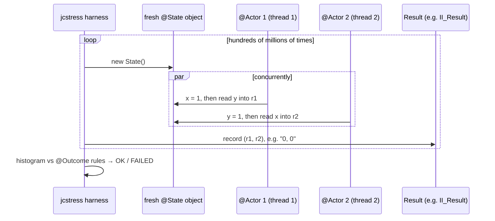

# jcstress: Testing the Java Memory Model

<span class="level l3">L3</span> <span class="level l4">L4</span> · ✅ the project below was built and run on JDK 21 (x86-64, 4 vCPU); the numbers are real

Normal unit tests can't prove the absence of a race: the bad interleaving might happen once in a billion runs. **jcstress**
(OpenJDK's concurrency stress harness) runs tiny "actor" methods concurrently **hundreds of millions of times** across JVM
configurations, records every outcome, and classifies each one as acceptable, interesting, or forbidden.

Project: [`examples/tools-lab/jcstress`](https://github.com/khiruashish/java-multithreading-playbook/tree/main/examples/tools-lab/jcstress)

```bash
cd examples/tools-lab/jcstress
mvn package                                         # target/jcstress.jar
java -jar target/jcstress.jar -m quick              # all tests, quick mode (~ minutes)
java -jar target/jcstress.jar -t StoreBuffering     # tests matching a regex
java -jar target/jcstress.jar -m default            # longer, more samples
# HTML report: results/index.html
```

## How a jcstress test works



## Test 1: store buffering (can both threads miss each other's write?)

```java title="StoreBufferingTest.java"
--8<-- "examples/tools-lab/jcstress/src/main/java/com/playbook/jcstress/StoreBufferingTest.java"
```

**Result (real):**

```text
.......... [OK] com.playbook.jcstress.StoreBufferingTest.Plain
  RESULT     SAMPLES     FREQ       EXPECT  DESCRIPTION
    0, 0  65,240,364   31.94%  Interesting  both reads before both writes: REORDERING
    0, 1  76,684,689   37.54%   Acceptable  some interleaving
    1, 0  62,338,738   30.52%   Acceptable  some interleaving
    1, 1       2,818   <0.01%   Acceptable  some interleaving
```

`0, 0` is impossible under any interleaving of the source code, yet it happened **65 million times (32%)**. Each CPU's write
sat in its **store buffer** while it read the other variable from cache. Even x86, with its strong memory model, allows this one reordering.
The `Volatile` variant declares `0, 0` **FORBIDDEN** and passed: `volatile` inserts the store-load fence.

## Test 2: lost update (`volatile` is not atomic)

```java title="LostUpdateTest.java"
--8<-- "examples/tools-lab/jcstress/src/main/java/com/playbook/jcstress/LostUpdateTest.java"
```

**Result (real):**

```text
.......... [OK] com.playbook.jcstress.LostUpdateTest.VolatilePlusPlus
  RESULT      SAMPLES     FREQ       EXPECT  DESCRIPTION
       1    9,166,492    4.17%  Interesting  LOST UPDATE: count++ is read-modify-write
       2  210,751,002   95.83%   Acceptable  both increments counted
```

Two increments produced `1` in **9 million** runs. `@Arbiter` runs after both actors finish and records the final state. The `Atomic`
variant (CAS) declares `1` forbidden and passed.

## Test 3: unsafe publication (plain vs `final` fields)

```java title="UnsafePublicationTest.java"
--8<-- "examples/tools-lab/jcstress/src/main/java/com/playbook/jcstress/UnsafePublicationTest.java"
```

On this **x86** machine, the `0` outcome (the reference is visible but the field isn't) **wasn't observed**. x86 doesn't reorder stores with other stores,
so the constructor's write becomes visible before the reference. The JMM still **allows** it, and on **ARM** (AWS Graviton, Apple
Silicon, many phones) it can show up. This is the lesson of jcstress: **"it passed on my laptop" proves nothing about the memory model**. Run
memory-model tests on the architectures you deploy to.

## Overall run

```text
(Results: 84 planned; 84 passed, 0 failed, 0 soft errs, 0 hard errs)
  Interesting tests: 2 matching test results.
```

84 runs = 6 tests × several JVM flag configurations (jcstress varies JIT modes and heap settings to provoke different code shapes).

## Outcome annotations cheat sheet

| `Expect` | Meaning | Use for |
|---|---|---|
| `ACCEPTABLE` | Allowed and expected | Normal interleavings |
| `ACCEPTABLE_INTERESTING` | Allowed by the JMM, but surprising | Documenting reorderings you want to *see* |
| `ACCEPTABLE_SPEC` | Allowed by the spec, rarely seen in practice | Edge cases |
| `FORBIDDEN` | The test **fails** if it's ever seen | Asserting your synchronization works |

Result types: `I_Result`, `II_Result`, `JJ_Result`, `Z_Result`, `L_Result`, … (field `r1`, `r2`, … of the given types).
Other annotations: `@Arbiter` (runs after the actors), and `@JCStressTest(Mode.Termination)` with a `@Signal` method (to test that a spinning thread *can* be stopped, e.g. that a stop flag needs `volatile`).
