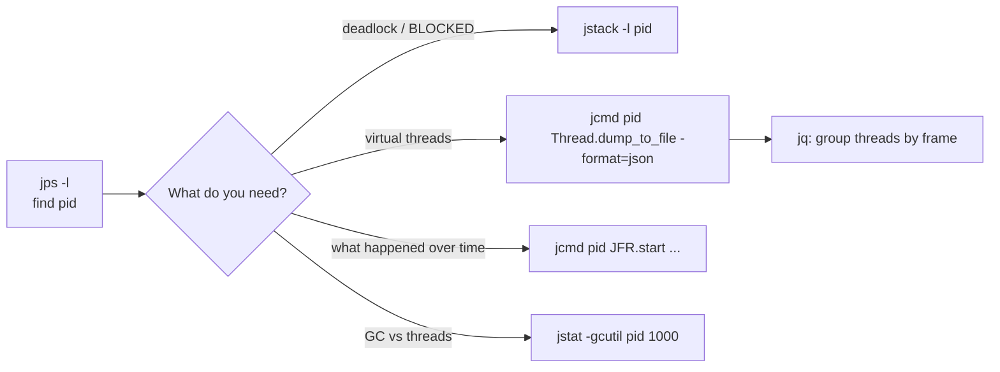
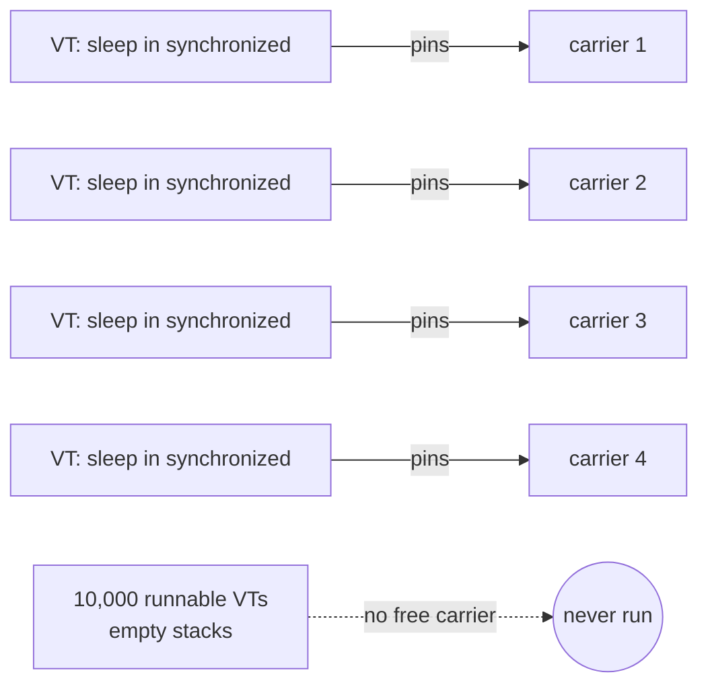

# JDK Command-line Tools

<span class="level l2">L2</span> <span class="level l3">L3</span> · ✅ all output on this page is real (JDK 21, `TroubledService`)

Every JDK ships with these tools: no install, and they work over SSH and inside containers (`kubectl exec`).

| Tool | One-line purpose | Concurrency use |
|---|---|---|
| `jps -l` | List Java processes and PIDs | Find the target |
| `jcmd <pid> <command>` | The Swiss-army knife: thread dumps, JFR, VM info, GC | **Use this first** |
| `jstack -l <pid>` | Classic platform-thread dump + deadlock detection | Deadlocks, BLOCKED threads |
| `jstat -gcutil <pid> 1000` | GC statistics every second | Is "slowness" really GC? |
| `jinfo -flags <pid>` | JVM flags of a running process | Check scheduler parallelism and GC settings |
| `jhsdb jstack --mixed --pid <pid>` | Java + native frames, even for a hung JVM | When `jcmd` can't attach |
| `jconsole`, VisualVM | GUI: live threads, deadlock button | Local debugging |



## `jps`: find the process

```text
$ jps -l
271 jdk.compiler/com.sun.tools.javac.launcher.Main      ← TroubledService.java launched as a single-file program
346 jdk.jcmd/sun.tools.jps.Jps
```

## `jcmd`: the commands that matter for concurrency

```text
$ jcmd <pid> help      (excerpt)
Thread.print  Thread.dump_to_file  JFR.start  JFR.dump  JFR.stop  JFR.check  JFR.view  JFR.configure
VM.flags  VM.info  VM.native_memory  VM.system_properties  VM.uptime  GC.heap_info  GC.class_histogram  GC.heap_dump
```

| Command | Use |
|---|---|
| `jcmd <pid> Thread.print -l` | Same as `jstack -l`: platform threads, locks, deadlock report |
| `jcmd <pid> Thread.dump_to_file -format=json <file>` | **All** threads, including virtual threads, grouped by thread container |
| `jcmd <pid> JFR.start duration=60s filename=rec.jfr settings=profile` | Start a flight recording ([JFR page](jfr-jmc.md)) |
| `jcmd <pid> JFR.view <view>` | (JDK 21+) Live summary tables from the running recording |
| `jcmd <pid> VM.flags` | Effective flags, e.g. GC and `-Xss` |

## `jstack -l`: deadlock detection

```text
$ jstack -l 717
...
Found one Java-level deadlock:
=============================
"payment-worker":
  waiting to lock monitor 0x00007f7380001170 (object 0x000000073745c258, a java.lang.Object),
  which is held by "refund-worker"
"refund-worker":
  waiting to lock monitor 0x00007f7374000fe0 (object 0x000000073745c248, a java.lang.Object),
  which is held by "payment-worker"
Java stack information for the threads listed above:
===================================================
"payment-worker":
	at TroubledService.lambda$main$0(TroubledService.java:35)
	- waiting to lock <0x000000073745c258> (a java.lang.Object)
	- locked <0x000000073745c248> (a java.lang.Object)
"refund-worker":
	at TroubledService.lambda$main$1(TroubledService.java:38)
	- waiting to lock <0x000000073745c248> (a java.lang.Object)
	- locked <0x000000073745c258> (a java.lang.Object)
```

**How to read it:** each thread **holds** (`- locked`) the object the other is **waiting for** (`- waiting to lock`). That's a
cycle, so it's a deadlock. Lines 35 and 38 point straight at the opposite-order `synchronized` blocks. The JVM finds this cycle for
you (monitors and `java.util.concurrent` locks). Fix it with [lock ordering](../coding-interview/11-deadlock.md).

### Lock contention in the same dump

```text
"hot-lock-1" #25 [743] prio=5 os_prio=0 cpu=954.38ms elapsed=7.49s ... waiting for monitor entry
   java.lang.Thread.State: BLOCKED (on object monitor)
	at TroubledService.lambda$main$2(TroubledService.java:45)
	- waiting to lock <0x000000073745c268> (a java.lang.Object)
```

Seven threads are `BLOCKED` on the same address `0x…c268`, while one holds it (`- locked <0x…c268>`). That's a **hot lock**.
Take three dumps, five seconds apart: if the same address shows up in all of them, it's systematic, not bad luck.

| Field | Meaning |
|---|---|
| `#25` / `[743]` / `nid=743` | Java thread id / OS thread id (match `nid` with `top -H` to find the hot thread) |
| `cpu=954.38ms elapsed=7.49s` | CPU used so far. A `BLOCKED` thread with rising CPU means it keeps getting the lock briefly |
| `State: BLOCKED (on object monitor)` | Waiting to enter `synchronized` |
| `WAITING (parking)` | `LockSupport.park`: j.u.c locks, queues, semaphores |
| `RUNNABLE` in `socketRead0` | Waiting on IO (the JVM can't see kernel waits) |

## JSON thread dump: the only way to see virtual threads

`jstack` and `Thread.print` show **platform threads only**. With 10,000 virtual threads in `TroubledService`, `jstack` printed
~370 lines. The JSON dump contains all 10,000+:

```text
$ jcmd 770 Thread.dump_to_file -format=json /tmp/threads.json
Created /tmp/threads.json                                      (1.0 MB)
```

### `jq` recipes

**1. Threads per container** (executor / scope):

```bash
jq -r '.threadDump.threadContainers[] | "\(.threads|length)\t\(.container)"' threads.json | sort -nr | head
```
```text
10004	java.util.concurrent.ThreadPerTaskExecutor@257fe2f5
18	<root>
4	ForkJoinPool-1/jdk.internal.vm.SharedThreadContainer@3379e3b3     ← the carrier threads
```

**2. Group all threads by their first application frame**. This is the most useful query of all:

```bash
jq -r '[.threadDump.threadContainers[].threads[]
        | (.stack | map(select(test("^(java\\.base/|jdk\\.)")|not)) | .[0] // "(jdk frames only)")]
       | group_by(.) | map({count: length, frame: .[0]}) | sort_by(-.count) | .[:6][]
       | "\(.count)\t\(.frame)"' threads.json
```
```text
9920	TroubledService.lambda$main$4(TroubledService.java:68)     ← CONNECTION_POOL.acquire()
11	(jdk frames only)
6	TroubledService.lambda$main$2(TroubledService.java:45)     ← hot lock
5	TroubledService.slowQuery(TroubledService.java:83)          ← the 5 permit holders
2	TroubledService.lambda$main$3(TroubledService.java:60)     ← pinned VTs
1	TroubledService.lambda$main$0(TroubledService.java:35)     ← deadlock
```

Diagnosis in one line: **9,920 requests wait for 5 "connections"**, which is pool exhaustion. The JVM isn't slow; the bottleneck is the
resource. (This is the virtual-thread version of a "Tomcat threads all busy" incident.)

**3. Count threads waiting in a specific call:**

```bash
jq '[.threadDump.threadContainers[].threads[] | select(any(.stack[]; test("Semaphore.acquire")))] | length' threads.json
```
```text
9920
```

### A real finding: carrier starvation (JDK 21)

Run the target with as many pinning threads as there are cores (`java TroubledService.java 4` on a 4-core machine) and the same
dump looks completely different:

```text
10000 threads with 0 frames        ← virtual threads that have NEVER been mounted
4 threads with 8 frames            ← the 4 pinned ones, each sleeping inside synchronized
```



`Thread.sleep` inside `synchronized` pins the carrier on JDK 21–23, and sleeping doesn't trigger the scheduler's compensation.
With every carrier pinned, the other 10,000 virtual threads **never start**. An empty `stack` in the JSON dump is the tell-tale
sign. JDK 24+ (JEP 491) unmounts in this case. On 21, use `ReentrantLock` ([Pinning](../virtual-threads/03-pinning.md)).

!!! note "JDK 21 JSON format"
    In JDK 21 each thread entry has only `tid`, `name`, and `stack`. There's no `virtual` flag or thread state. Later JDKs add more fields.
    The recipes above use only `stack`, so they work everywhere.

## `jstat`: rule out GC first

```text
$ jstat -gcutil 271 1000 3
  S0     S1     E      O      M     CCS    YGC     YGCT     FGC    FGCT     CGC    CGCT       GCT
     -  83.36  68.75   2.22  98.03  94.34      2     0.022     0     0.000     0     0.000     0.022
```

`YGC` and `GCT` barely move, so GC isn't the problem, and you can look at threads and locks instead.

## Programmatic: `ThreadMXBean`

```java
ThreadMXBean mx = ManagementFactory.getThreadMXBean();
long[] ids = mx.findDeadlockedThreads();           // monitors + ownable synchronizers; platform threads only
ThreadInfo[] infos = mx.dumpAllThreads(true, true); // locked monitors + synchronizers
```

The [deadlock coding problem](../coding-interview/11-deadlock.md) uses this to detect and report the cycle at runtime.

## In Kubernetes

```bash
kubectl exec <pod> -- jcmd 1 Thread.print -l > dump-$(date +%s).txt
kubectl exec <pod> -- jcmd 1 Thread.dump_to_file -format=json /tmp/t.json && kubectl cp <pod>:/tmp/t.json ./t.json
```

Distroless images have no `jcmd`. Use an ephemeral debug container with a JDK (`kubectl debug -it <pod> --image=eclipse-temurin:21-jdk --target=<container>`),
or expose `/actuator/threaddump` ([Observability](observability.md)).

## Thread-dump analyzers

| Tool | Good for |
|---|---|
| `jq` (above) | Scriptable, works on millions of threads, CI-friendly |
| IntelliJ IDEA → *Analyze Stack Trace or Thread Dump* | Groups identical stacks and folds JDK frames |
| TDA (Thread Dump Analyzer, open source) | Comparing several dumps over time |
| fastThread.io (online) | Quick visual report. **Don't upload dumps containing secrets or PII** |
