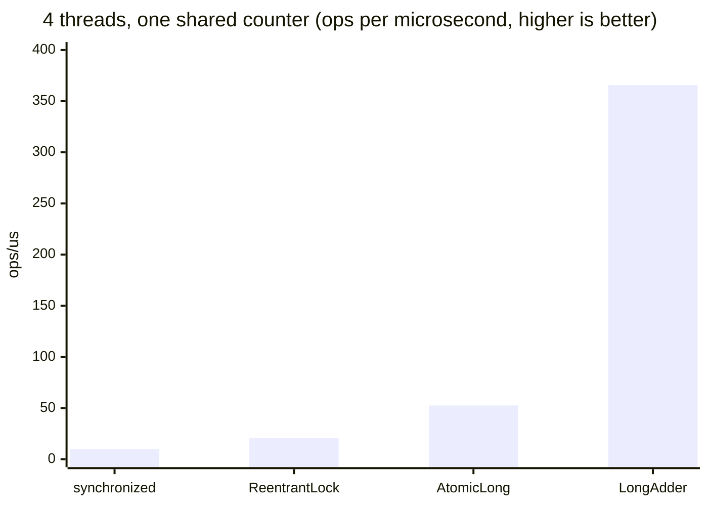

# JMH: Java Microbenchmark Harness

<span class="level l3">L3</span> · ✅ the project below was built and run on JDK 21 (4 vCPU); the numbers are real

Hand-written timing loops lie, because of JIT warm-up, dead-code elimination, constant folding, and GC noise. **JMH** (from the OpenJDK team)
handles all of that: separate forked JVMs, warm-up iterations, blackholes, and statistics with error bars.

Project: [`examples/tools-lab/jmh`](https://github.com/khiruashish/java-multithreading-playbook/tree/main/examples/tools-lab/jmh)

```bash
cd examples/tools-lab/jmh
mvn package                                   # builds target/benchmarks.jar (shaded, main = org.openjdk.jmh.Main)
java -jar target/benchmarks.jar -l            # list benchmarks
java -jar target/benchmarks.jar CounterBenchmark
java -jar target/benchmarks.jar ExecutorBenchmark -prof gc
java -jar target/benchmarks.jar -h            # all options
```

## Benchmark 1: contended counters

Four threads increment **one shared** counter. `@State(Scope.Group)` plus `@Group`/`@GroupThreads(4)` is the JMH way of saying
"these 4 threads share this state".

```java title="CounterBenchmark.java"
--8<-- "examples/tools-lab/jmh/src/main/java/com/playbook/jmh/CounterBenchmark.java"
```

**Result (real):**

```text
Benchmark                        Mode  Cnt    Score    Error   Units
CounterBenchmark.atomicLong     thrpt    5   52.478 ±  9.634  ops/us
CounterBenchmark.longAdder      thrpt    5  365.815 ± 17.587  ops/us
CounterBenchmark.reentrantLock  thrpt    5   20.521 ±  1.747  ops/us
CounterBenchmark.synchronized   thrpt    5    9.759 ±  2.024  ops/us
```



**What it teaches:**

* `LongAdder` is **7×** faster than `AtomicLong` and **37×** faster than `synchronized` under contention. Each thread mostly updates
  its own striped cell, while `AtomicLong` makes every CAS fight over one cache line.
* Locks pay for parking and waking threads. `ReentrantLock` beat `synchronized` here, but that varies with JDK version and contention.
  **Measure your case**; don't quote a rule.
* `LongAdder.sum()` isn't an atomic snapshot, so for IDs or sequence numbers you still need `AtomicLong`.

## Benchmark 2: platform pool vs virtual threads

One "request" fans out N blocking 10 ms calls and waits for all of them. `@Param` runs the benchmark for each fan-out size.

```java title="ExecutorBenchmark.java"
--8<-- "examples/tools-lab/jmh/src/main/java/com/playbook/jmh/ExecutorBenchmark.java"
```

**Result (real, `-prof gc`):**

```text
Benchmark                                             (fanOut)  Mode  Cnt       Score        Error   Units
ExecutorBenchmark.platformPool200                          100  avgt    3      12.573 ±      7.813   ms/op
ExecutorBenchmark.platformPool200:gc.alloc.rate.norm       100  avgt    3   10410.562 ±  10895.122    B/op
ExecutorBenchmark.platformPool200                         1000  avgt    3      54.354 ±      6.576   ms/op
ExecutorBenchmark.platformPool200:gc.alloc.rate.norm      1000  avgt    3   74973.388 ±  41761.902    B/op
ExecutorBenchmark.virtualThreads                           100  avgt    3      10.548 ±      0.915   ms/op
ExecutorBenchmark.virtualThreads:gc.alloc.rate.norm        100  avgt    3   79290.425 ±    181.851    B/op
ExecutorBenchmark.virtualThreads                          1000  avgt    3      11.099 ±      1.063   ms/op
ExecutorBenchmark.virtualThreads:gc.alloc.rate.norm       1000  avgt    3  855716.386 ± 511178.041    B/op
```

| Fan-out | Pool(200) | Virtual threads | Why |
|---|---|---|---|
| 100 | 12.6 ms | 10.5 ms | Both fit: 100 < 200 threads, so the time ≈ one 10 ms call |
| 1,000 | **54.4 ms** | **11.1 ms** | The pool runs 1000/200 = 5 waves × 10 ms. VTs all wait at once |

**`-prof gc` shows the cost:** virtual threads allocate about **79 KB per 100 tasks, or ~800 bytes per virtual thread** (thread object + continuation +
stack chunks). The pool reuses threads and allocates far less. That's the honest trade-off: VTs swap **threads** (an OS-limited resource) for
**heap allocation** (which the GC handles cheaply). It's the reason you don't create VTs for nanosecond-sized CPU tasks.

## The rules that make benchmarks correct

| Rule | In the code |
|---|---|
| Return the result or use a `Blackhole`, or the JIT deletes the work | Methods return `long`/`int` |
| Use `@State` for inputs (not constants), or the JIT folds them | Counters live in the state object |
| Fork at least once (`@Fork(1)`) so profiles from other benchmarks don't leak in | `@Fork(1)` |
| Warm up | `@Warmup(iterations = 3)` |
| Read the **error** column: overlapping intervals mean "no proven difference" | `±` |
| Test contention explicitly | `@GroupThreads(4)`, `@Threads(n)`, or `-t 4` |
| Look at allocation, not only time | `-prof gc` |
| Check what was actually compiled | `-prof perfasm` (Linux, needs hsdis) |

## Useful command-line options

```bash
java -jar target/benchmarks.jar CounterBenchmark -f 3 -wi 5 -i 10      # 3 forks, 5 warmups, 10 measurements
java -jar target/benchmarks.jar ExecutorBenchmark -p fanOut=10000      # override a @Param
java -jar target/benchmarks.jar -t 8 SomeBenchmark                     # 8 threads
java -jar target/benchmarks.jar -rf json -rff results.json             # machine-readable (jmh.morethan.io visualizes it)
java -jar target/benchmarks.jar -prof stack                            # where benchmark threads spend time (incl. waiting)
```
