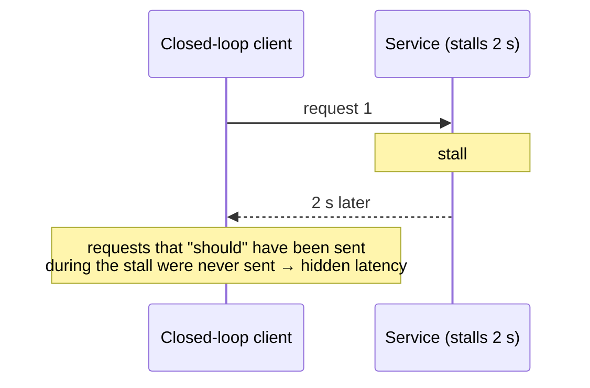

# Load Testing

<span class="level l3">L3</span> · Tools are described with ready-to-use scripts. **No load-test numbers were measured for this page.**

Micro-benchmarks (JMH) tell you which *code* is faster. Load tests tell you how the **whole service** behaves under concurrency:
throughput, tail latency, where it saturates, and how it fails.

| Tool | Language | Strengths | Watch out |
|---|---|---|---|
| **k6** | JavaScript | Constant-arrival-rate executor, thresholds as CI gates, good docs | Not a JVM tool (that's fine) |
| **Gatling** | Java/Kotlin/Scala DSL | Rich HTML reports, open/closed workload models | Heavier setup |
| **wrk2** | CLI + Lua | Constant rate, accurate HDR latency histograms | Linux build, HTTP only |
| **hey** / **oha** | CLI | Quick smoke load | Closed-loop: suffers from coordinated omission |
| **JMeter** | GUI/XML | Protocol variety, many teams know it | Verbose, closed-loop by default |
| **vegeta** | CLI | Constant rate, attack/report pipeline | HTTP only |

## Coordinated omission: why the tool's model matters

A **closed-loop** tool (N virtual users, each sending the next request after the previous one returns) automatically *slows down
when your service slows down*, so it never measures the queueing your real users would experience. **Open-model / constant-rate** tools
(k6 `constant-arrival-rate`, wrk2 `-R`, Gatling `constantUsersPerSec`) keep sending at the target rate, so latency includes queueing
delay.



## k6: constant arrival rate against the sample

```javascript
// load/product-page.js — run: k6 run load/product-page.js
import http from 'k6/http';
import { check } from 'k6';

export const options = {
  scenarios: {
    steady: {
      executor: 'constant-arrival-rate',
      rate: 1000, timeUnit: '1s',        // 1000 req/s regardless of response time
      duration: '2m',
      preAllocatedVUs: 500, maxVUs: 5000,
    },
  },
  thresholds: {
    http_req_failed: ['rate<0.01'],      // < 1% errors (503 sheds count as errors here)
    http_req_duration: ['p(99)<400'],    // p99 under 400 ms or the run fails (CI gate)
  },
};

export default function () {
  const res = http.get(`http://localhost:8080/api/products/p-${__ITER % 1000}/page`);
  check(res, { 'status 200': (r) => r.status === 200 });
}
```

## wrk2: quick constant-rate test

```bash
wrk -t4 -c400 -d60s -R2000 --latency http://localhost:8080/api/products/p-1/page
```

## Experiment recipe: virtual vs platform threads

```bash
# A: virtual threads (default in the sample)
java -jar target/spring-boot-vt-1.0.0.jar
k6 run load/product-page.js

# B: platform threads (Tomcat's 200-thread pool)
java -jar target/spring-boot-vt-1.0.0.jar --spring.threads.virtual.enabled=false
k6 run load/product-page.js
```

Compare at the **same request rate**: p50/p99, error rate (503s from admission control are *good* failures), CPU, heap after GC,
and the bulkhead and Hikari metrics. Then raise the rate until p99 breaks the SLO; that rate is your capacity. Repeat on hardware
like production, because a laptop's numbers don't transfer.
