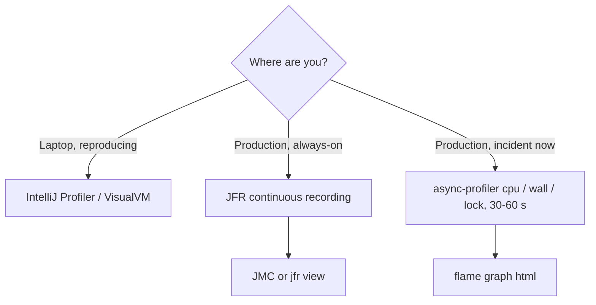

# Profilers

<span class="level l3">L3</span> · async-profiler **CPU mode was run** for this page. Its other modes and the GUI profilers are documented, not run here.

## Why sampling profilers, and why async-profiler

Classic JVMTI profilers only sample at **safepoints**, so they show where threads *stopped*, not where time was *spent*
(safepoint bias). **async-profiler** uses `perf_events` and `AsyncGetCallTrace` to sample anywhere, including native and kernel
frames, with a few percent overhead. That makes it the standard tool for CPU and lock analysis, and it's what IntelliJ's profiler uses internally.

| Mode | Flag | Answers |
|---|---|---|
| CPU | `-e cpu` | Where is CPU time spent? |
| Wall clock | `-e wall` (use `-t` for per-thread) | Where is **elapsed** time spent, including waiting, sleeping, and blocking? Best for "slow but CPU is idle" |
| Lock | `-e lock` | Which monitors/locks do threads wait on, and for how long? |
| Allocation | `-e alloc` | Who allocates (TLAB-sampled)? |
| Interval | `-i 1ms` | Sampling rate |
| Output | `-f out.html` (flame graph), `-o flat=10`, `-o collapsed`, `-f out.jfr` | Report format |

## Install

```bash
curl -LO https://github.com/async-profiler/async-profiler/releases/download/v4.1/async-profiler-4.1-linux-x64.tar.gz
tar xzf async-profiler-4.1-linux-x64.tar.gz
./async-profiler-4.1-linux-x64/bin/asprof --version
```

On Linux, allow perf events for non-root users (`sysctl kernel.perf_event_paranoid=1`) or run as the JVM's user. In containers,
`-e cpu` may fall back to `itimer`, which is fine for most work.

## CPU profile of `TroubledService` (real output)

```text
$ asprof -e cpu -d 8 -o flat=8 <pid>
Profiling for 8 seconds
Done
--- Execution profile ---
Total samples       : 1753
unknown_Java        : 14 (0.80%)
not_walkable_Java   : 526 (30.01%)

          ns  percent  samples  top
  ----------  -------  -------  ---
  5451300111   30.22%      545  [vdso]
  4053414665   22.47%      391  TroubledService.lambda$main$2
  2414299849   13.39%      232  _raw_spin_unlock_irqrestore_[k]
  2218522807   12.30%      204  finish_task_switch.isra.0_[k]
  2019718127   11.20%      202  TroubledService.lambda$main$5
   169945687    0.94%       17  os::javaTimeNanos
```

**How to read it:**

* `lambda$main$2` (the hot-lock loop, 22%) and `lambda$main$5` (the CPU burner, 11%) are the application's CPU consumers, which matches
  `jfr view hot-methods`.
* `[vdso]` (30%) is `System.nanoTime()` in the burner's loop (a fast kernel clock call).
* `_raw_spin_unlock_irqrestore_[k]` and `finish_task_switch_[k]` are **kernel** frames for context switching and futex wake-ups. That's the
  cost of 8 threads fighting over one monitor: the OS keeps parking and waking them. JVMTI profilers can't show this at all.
* `not_walkable_Java` (30%) are samples where the Java stack couldn't be walked (often in the middle of a transition). Adding `-XX:+DebugNonSafepoints`
  and running longer reduces the noise.

For a visual answer, write a flame graph:

```bash
asprof -e cpu -d 30 -f cpu.html <pid>       # open cpu.html: width = time, hover for details
```

## Lock and wall-clock profiling (commands to use)

These modes weren't run for this page, so there's no output to show. Here is what you'd use them for on the same target:

```bash
# Which locks do threads wait on? Expect TroubledService.lambda$main$2 / java.lang.Object (HOT_LOCK) to dominate.
asprof -e lock -d 30 -f lock.html <pid>

# Where does elapsed time go per thread? Expect the deadlocked threads at 100% in monitor enter,
# and the pinned virtual threads' carriers in Thread.sleep.
asprof -e wall -t -d 30 -f wall.html <pid>

# Start profiling at JVM launch as an agent
java -agentpath:/path/to/libasyncProfiler.so=start,event=cpu,file=startup.html -jar app.jar
```

!!! tip "Wall clock is the concurrency profiler"
    CPU profiles hide waiting. If latency is high but CPU is low, `-e wall -t` shows which threads spend their time in `park`,
    `Object.wait`, socket reads, or `getConnection`. The flame graph is then split per thread.

## Other profilers

| Profiler | Cost | Strengths for concurrency |
|---|---|---|
| **IntelliJ IDEA Profiler** | Ultimate edition | One click from the run configuration. Uses async-profiler + JFR. Flame graph, call tree, and timeline with thread states |
| **VisualVM** | Free | Threads tab (timeline + "Thread Dump" + deadlock detection), sampler, JFR viewer plugin |
| **JProfiler** | Commercial | Thread history, "Monitor Usage" (who blocked whom), deadlock graph, virtual thread support |
| **YourKit** | Commercial | Thread and monitor profiling, "deadlocks" tab, CPU flame graphs |
| **JDK Mission Control** | Free | See [JFR & JMC](jfr-jmc.md). Analyzes JFR, so it's safe for production recordings |

## Which one, when


