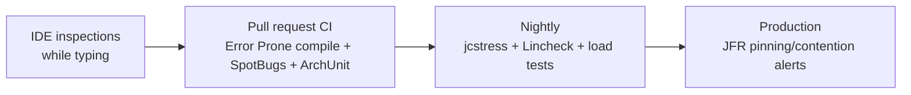

# Static Analysis for Concurrency

<span class="level l2">L2</span> <span class="level l3">L3</span> · ✅ SpotBugs and Error Prone were run against deliberately buggy classes in `examples/tools-lab/testing-and-analysis`

Static analysis catches lock-discipline mistakes **before** they become 3 a.m. incidents, and it runs in CI on every commit.

| Tool | How it works | Best at |
|---|---|---|
| **Error Prone** `@GuardedBy` | javac plugin. Fails the **compile** | Enforcing "this field is only touched under that lock" |
| **SpotBugs** (MT_CORRECTNESS) | Bytecode analysis after compile | Inconsistent synchronization, DCL bugs, `wait` not in a loop, `notify` vs `notifyAll`, … |
| Checker Framework Lock Checker | Pluggable type system | Strong proofs for `@GuardedBy` / `@Holding` |
| IntelliJ IDEA inspections | IDE, live | "Field accessed in both synchronized and unsynchronized contexts", "wait() not in loop", "synchronization on non-final field" |
| SonarQube / PMD | Rule engines in CI | "Double-checked locking", "Synchronizing on String", "Thread.sleep in tests" |
| ArchUnit | Unit tests over your architecture | House rules: "no pooling of virtual threads", "no `parallelStream` in services" |

## Annotate your intent

```java
import com.google.errorprone.annotations.concurrent.GuardedBy;   // or javax.annotation.concurrent / jcip
import com.google.errorprone.annotations.ThreadSafe;
import com.google.errorprone.annotations.Immutable;

@ThreadSafe
class Account {
    private final Object lock = new Object();
    @GuardedBy("lock") private long balanceMinor;
}
```

Even without tooling, `@GuardedBy` documents which lock protects which field, and that's the first thing a reviewer needs to know.

## Error Prone: `@GuardedBy` checked at compile time

```java title="GuardedAccount.java (deliberately wrong)"
--8<-- "examples/tools-lab/testing-and-analysis/src/errorprone-demo/java/com/playbook/tools/GuardedAccount.java"
```

```bash
mvn -Perrorprone compile
```

**Real output: the build fails:**

```text
[ERROR] .../GuardedAccount.java:[17,8] error: [GuardedBy] This access should be guarded by 'this.lock', which is not currently held
    (see https://errorprone.info/bugpattern/GuardedBy)
```

Maven setup (the `errorprone` profile in the project's `pom.xml`). Note the flags required on JDK 21:

```xml
<compilerArgs>
  <arg>-XDcompilePolicy=simple</arg>
  <arg>-XDaddTypeAnnotationsToSymbol=true</arg>   <!-- required by Error Prone on JDK 21, or it refuses to start -->
  <arg>--should-stop=ifError=FLOW</arg>
  <arg>-Xplugin:ErrorProne</arg>
  <!-- plus -J--add-exports / --add-opens for jdk.compiler packages (see pom.xml) -->
</compilerArgs>
<annotationProcessorPaths>
  <path><groupId>com.google.errorprone</groupId><artifactId>error_prone_core</artifactId><version>2.51.0</version></path>
</annotationProcessorPaths>
```

Other Error Prone concurrency checks: `DoubleCheckedLocking`, `SynchronizeOnNonFinalField`, `WaitNotInLoop`,
`ThreadPriorityCheck`, `FutureReturnValueIgnored` (a submitted task whose exception is never observed), `Immutable`/`ThreadSafe` enforcement.

## SpotBugs: inconsistent synchronization

```java title="InconsistentCache.java (deliberately wrong)"
--8<-- "examples/tools-lab/testing-and-analysis/src/main/java/com/playbook/tools/InconsistentCache.java"
```

```bash
mvn compile spotbugs:check
```

**Real output:**

```text
[ERROR] Low: Inconsistent synchronization of com.playbook.tools.InconsistentCache.size; locked 83% of time
        Unsynchronized access at InconsistentCache.java:[line 29]
        Synchronized access at InconsistentCache.java:[line 24] ... [line 19] ... [line 15]  IS2_INCONSISTENT_SYNC
```

!!! warning "Lesson learned while writing this page: set the threshold to Low"
    With the common `<threshold>Medium</threshold>`, SpotBugs reported **nothing** for this real bug. `IS2_INCONSISTENT_SYNC` is a heuristic
    ("locked 83% of time"), and it's ranked **Low** priority. For concurrency checks, run with `threshold=Low` and filter to
    `MT_CORRECTNESS` (as `spotbugs-mt-only.xml` does) to keep the noise down.

Other SpotBugs MT patterns: `DC_DOUBLECHECK`, `JLM_JSR166_UTILCONCURRENT_MONITORENTER` (synchronizing on a `ReentrantLock` object),
`SWL_SLEEP_WITH_LOCK_HELD`, `UL_UNRELEASED_LOCK`, `NN_NAKED_NOTIFY`, `WA_NOT_IN_LOOP`, `STCAL_INVOKE_ON_STATIC_DATE_FORMAT_INSTANCE`,
`AT_NONATOMIC_OPERATIONS_ON_SHARED_VARIABLE`.

## ArchUnit: your team's concurrency rules as tests

```java
@AnalyzeClasses(packages = "com.acme")
class ConcurrencyRulesTest {

    @ArchTest
    static final ArchRule noThreadLocalFields = fields().that().haveRawType(ThreadLocal.class)
            .should().bePrivate().andShould().beStatic()
            .because("ThreadLocal caches multiply per virtual thread; use ScopedValue or a shared instance");

    @ArchTest
    static final ArchRule noRawThreads = noClasses().that().resideInAPackage("..application..")
            .should().callConstructor(Thread.class, Runnable.class)
            .because("use an injected executor or Thread.ofVirtual() via the platform's helpers");

    @ArchTest
    static final ArchRule noParallelStreamsInServices = noClasses().that().resideInAPackage("..application..")
            .should().callMethod(java.util.Collection.class, "parallelStream")
            .because("parallel streams share the common pool; blocking IO there starves the JVM");
}
```

## Where to run what


