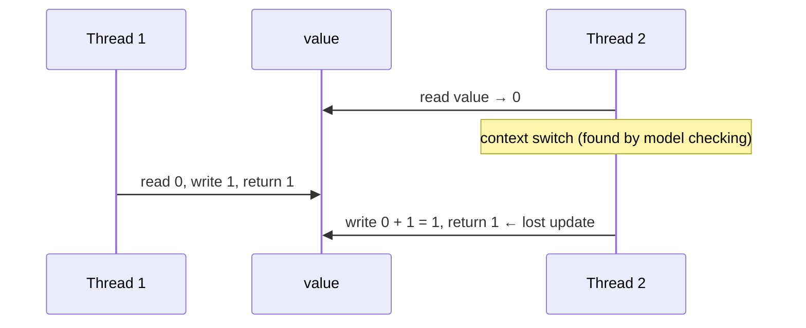

# Testing Libraries for Concurrent Code

<span class="level l2">L2</span> <span class="level l3">L3</span> · ✅ Awaitility and Lincheck were run (`examples/tools-lab/testing-and-analysis`, `mvn test`)

| Library | Problem it solves | Verdict |
|---|---|---|
| **JUnit 5 + virtual threads** | Hammer code with thousands of threads cheaply | Use everywhere ([examples](../production/testing.md)) |
| **Awaitility** | "Eventually X happens" without `Thread.sleep` | Default for async assertions |
| **Lincheck** | Is my concurrent data structure linearizable? Shows the failing interleaving | Use for custom data structures and caches |
| **jcstress** | Memory-model and atomicity at the instruction level | [Own page](jcstress.md) |
| ConcurrentUnit | Assertions from worker threads (`waiter.assertEquals` + `resume`) | Simple, older |
| tempus-fugit | `@Concurrent`, `@Repeating` JUnit rules | JUnit 4-era |
| VMLens | Explores interleavings and finds races/deadlocks in JUnit tests | Worth a look |
| Thread Weaver (Google) | Forces specific interleavings with breakpoints | Archived, historical |
| Testcontainers | Real DB/Kafka for concurrency tests involving locks/`SKIP LOCKED` | Use for distributed concurrency |

## Awaitility: assert asynchronous outcomes

`Thread.sleep(500)` in tests is either **too short** (flaky on a slow CI machine) or **too long** (slow on every machine). Awaitility
**polls** a condition until it's true or a timeout expires.

```java title="AwaitilityTest.java"
--8<-- "examples/tools-lab/testing-and-analysis/src/test/java/com/playbook/tools/AwaitilityTest.java"
```

The class under test is a plain asynchronous worker:

```java title="OrderProcessor.java"
--8<-- "examples/tools-lab/testing-and-analysis/src/main/java/com/playbook/tools/OrderProcessor.java"
```

| API | Meaning |
|---|---|
| `await().atMost(d).until(callable)` | Poll until `true`, or fail after `d` with a `ConditionTimeoutException` |
| `untilAsserted(() -> assertThat(...))` | Retry an AssertJ/JUnit assertion. The failure shows the last assertion message |
| `pollInterval(d)`, `pollDelay(d)` | How often, and how long before the first check |
| `during(d)` | The condition must **stay** true for the whole window ("nothing happens") |
| `ignoreExceptions()` | Treat exceptions thrown while polling as "not yet" |

## Lincheck: checking linearizability automatically

You declare the operations. Lincheck generates concurrent scenarios, runs them (stress mode), or **systematically explores
interleavings** (model checking mode). It then checks that every result matches *some* sequential order. On failure it prints the
exact interleaving.

```java title="LincheckTest.java"
--8<-- "examples/tools-lab/testing-and-analysis/src/test/java/com/playbook/tools/LincheckTest.java"
```

```java title="BrokenCounter.java (the bug)"
--8<-- "examples/tools-lab/testing-and-analysis/src/main/java/com/playbook/tools/BrokenCounter.java"
```

**Real Lincheck report for `BrokenCounter`** (columns trimmed for width. The read-arrow printed as `?` in this console's encoding and is shown here as `➜`):

```text
= Invalid execution results =
| ------------------------------------------- |
|       Thread 1       |       Thread 2       |
| ------------------------------------------- |
| incrementAndGet(): 1 | incrementAndGet(): 1 |
| ------------------------------------------- |

The following interleaving leads to the error:
| -------------------------------------------------------------------------------------------- |
|       Thread 1       |                                Thread 2                               |
| -------------------------------------------------------------------------------------------- |
|                      | incrementAndGet(): 1                                                  |
|                      |   counter.incrementAndGet(): 1 at LincheckTest$BrokenCounterTest...   |
|                      |     value ➜ 0 at BrokenCounter.incrementAndGet(BrokenCounter.java:7)  |
|                      |     switch                                                            |
| incrementAndGet(): 1 |                                                                       |
|                      |     value = 1 at BrokenCounter.incrementAndGet(BrokenCounter.java:7)  |
|                      |   result: 1                                                           |
| -------------------------------------------------------------------------------------------- |
```

**How to read it:** both increments returned `1`, which no sequential order can produce (one of them must return 2). The trace shows
Thread 2 **read** `value` (0), then a context **switch** let Thread 1 do its whole increment, and then Thread 2 **wrote** its stale `0 + 1`.
That's the lost update, found by systematic exploration rather than luck, and pointed at the exact line. `AtomicCounterTest` passes both
model checking and stress mode.



Maven coordinates: `org.jetbrains.kotlinx:lincheck-jvm` (not `lincheck`, which is only the Kotlin-multiplatform root). Surefire needs
`-XX:+EnableDynamicAgentLoading` on JDK 21+ to avoid the dynamic-agent warning.

## Plain JUnit: the "hammer" pattern

Every solution in this playbook is tested this way: thousands of virtual threads, then assert an **invariant**:

```java
@Test
void transfersConserveMoney() throws Exception {
    try (var ex = Executors.newVirtualThreadPerTaskExecutor()) {
        for (int i = 0; i < 200_000; i++) ex.submit(() -> bank.transfer(randomFrom(), randomTo(), randomAmount()));
    }
    assertThat(bank.total()).isEqualTo(INITIAL_TOTAL);
}
```

Tips: assert invariants (sum, count, no negatives), not specific interleavings. Coordinate with latches, not sleeps. And repeat the test
(`@RepeatedTest(50)`) for code that can fail intermittently.
