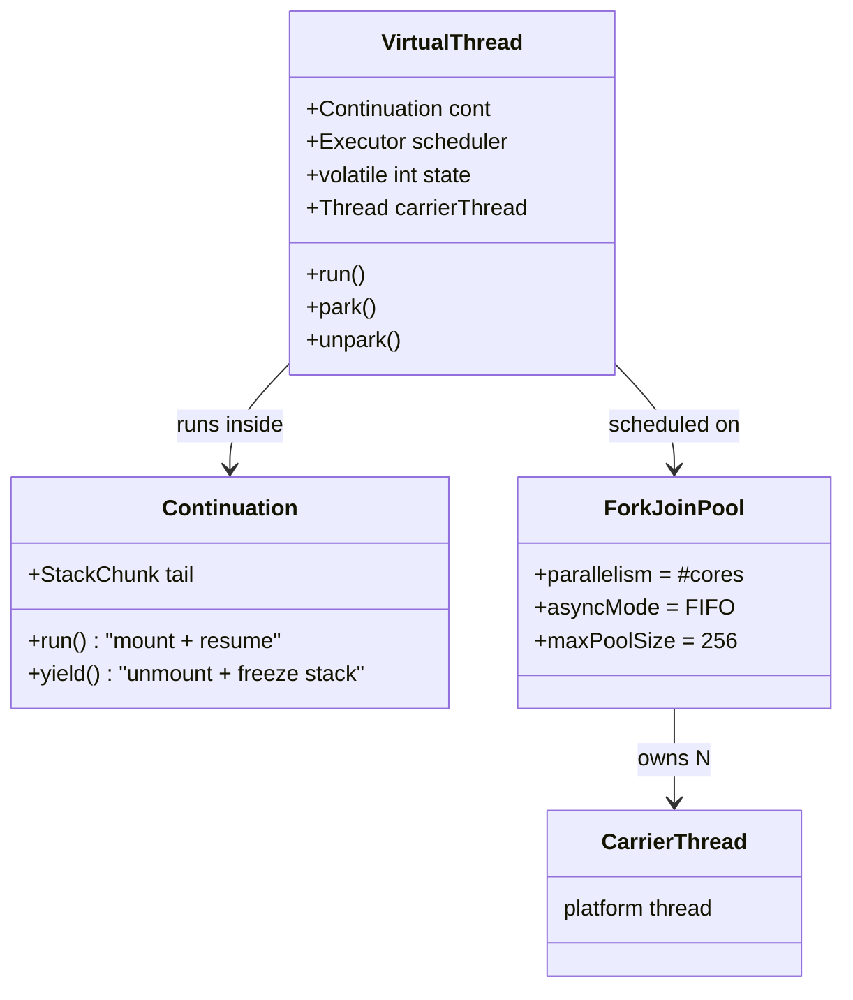
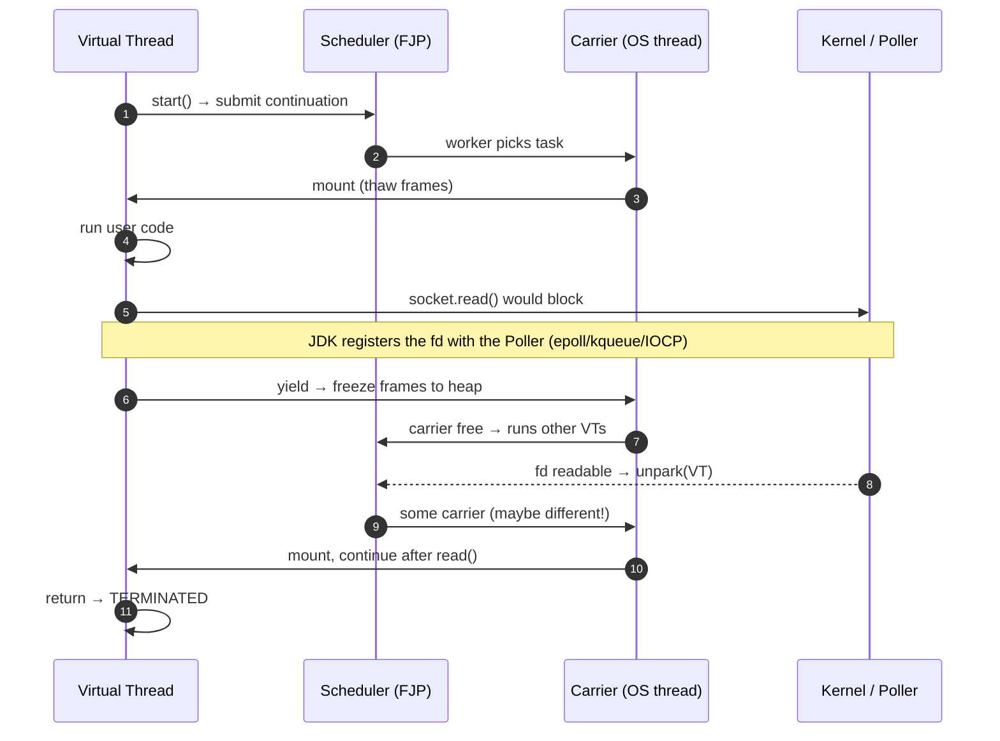

# L2: How Virtual Threads Work

L2 · 3–5 yrs L3

## The three pieces

1. **Continuation** (`jdk.internal.vm.Continuation`): a resumable unit of execution. `yield()` *freezes*
   the frames into heap `StackChunk` objects. `run()` *thaws* them back onto the carrier stack.
2. **Scheduler**: a dedicated FIFO `ForkJoinPool`. `parallelism` defaults to `availableProcessors()`.
3. **Carrier thread**: a platform thread in that pool that mounts VTs.

## Mount / unmount lifecycle

Key consequences:

* A VT may **resume on a different carrier**. Never assume a carrier's identity or keep carrier-local state.
* `Thread.currentThread()` returns the **virtual** thread, never the carrier.
* Unmounting copies only the frames that changed (lazy copy), which is why parking costs around 100s of nanoseconds.

## What unmounts and what doesn't

| Operation | JDK 21–23 | JDK 24+ |
|---|---|---|
| `Thread.sleep`, `LockSupport.park` | Unmounts | Unmounts |
| `BlockingQueue.take/put`, `ReentrantLock`, `Semaphore`, `CountDownLatch` | Unmounts | Unmounts |
| Socket IO (`java.net.Socket`, `SocketChannel`, `HttpClient`, JDBC drivers using sockets) | Unmounts (poller) | Unmounts |
| `synchronized` block where the VT blocks inside | **Pins** | Unmounts (JEP 491) |
| Contended `synchronized` entry | **Pins** | Unmounts |
| `Object.wait()` | **Pins** (compensates by adding a carrier) | Unmounts |
| File IO (`FileInputStream`, `Files.*`) | **Captures** the carrier; the pool compensates with an extra carrier | Same |
| DNS lookup (`InetAddress`) | Captures the carrier, with compensation | Same |
| Native method / JNI / foreign function call that blocks | **Pins** | **Pins** |
| Class initializer (`<clinit>`) blocking | Pins | Pins |

"Captures with compensation" means the scheduler temporarily adds a carrier (up to
`jdk.virtualThreadScheduler.maxPoolSize`, default 256) so that the other VTs keep running.

## The scheduler knobs

| System property | Default | Meaning |
|---|---|---|
| `jdk.virtualThreadScheduler.parallelism` | #cores | Carriers that run VTs concurrently |
| `jdk.virtualThreadScheduler.maxPoolSize` | max(parallelism, 256) | Cap including compensation threads |
| `jdk.virtualThreadScheduler.minRunnable` | max(parallelism/2, 1) | Minimum runnable carriers |
| `jdk.unparker.maxPoolSize` | – | Timer threads that wake sleeping VTs |

You almost never tune these. Watch for **container CPU limits**: `availableProcessors()` respects cgroups, so a
pod limited to 2 CPUs gets 2 carriers.

## Memory: why a million threads fit

* A platform thread reserves its entire `-Xss` stack (1 MB virtual, committed lazily but never returned).
* A VT's frames live in `StackChunk` heap objects that hold only the frames actually in use, often **< 1 KB** for a parked
  web request. 1M parked VTs need roughly **1 GB or less** of heap, and they are garbage-collected like any other object.
* GC treats stack chunks as ordinary heap objects. Generational ZGC (default generational from JDK 23) handles
  this well.

## Preemption: there isn't any (yet)

VTs are **not time-sliced**. A VT that runs CPU work without blocking keeps its carrier until it blocks or finishes.
With 8 carriers and 8 CPU-spinning VTs, all other VTs starve. That's why CPU work goes to a bounded platform pool
([L7 pitfalls](07-pitfalls.md)).
