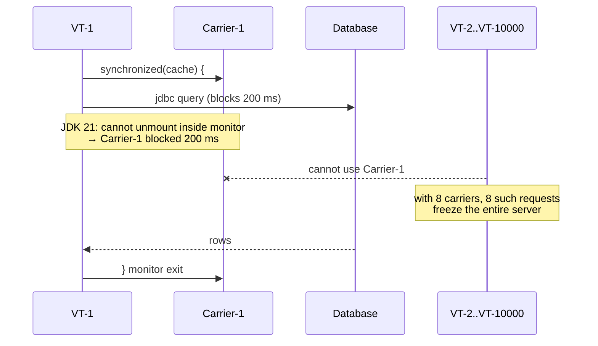

# L3: Pinning, and How JEP 491 Fixed `synchronized`

<span class="level l2">L2</span> <span class="level l3">L3 · 6–9 yrs</span>

## What is pinning?

A virtual thread is **pinned** when it cannot unmount from its carrier while blocked. The carrier OS thread blocks too.
If all carriers are pinned, **every** virtual thread in the JVM stops making progress, even ones that have nothing to
do with the lock.



## Why it happened on JDK 21–23

HotSpot recorded monitor ownership by the **carrier** thread (through the lock record on the native stack). If the VT
unmounted while holding the monitor, another VT mounted on that carrier would appear to own the lock.

## JEP 491 (JDK 24): synchronize virtual threads without pinning

The JVM now tracks monitor ownership by the **virtual thread**. In practice:

* Blocking inside `synchronized` → unmounts.
* Contended `synchronized` entry → the VT parks and unmounts. When the monitor is released, the VT is queued to the scheduler.
* `Object.wait()` → unmounts.
* `-Djdk.tracePinnedThreads` was **removed**. Use the JFR event `jdk.VirtualThreadPinned` instead.

Remaining pin cases on 24+: **native frames** on the stack (JNI calls, or a foreign-function call that calls back into Java) and
blocking inside a **class initializer**.

## Detecting pinning

=== "JDK 21–23"

    ```bash
    java -Djdk.tracePinnedThreads=full -jar app.jar
    # prints a stack trace with '<== monitors:1' at the frame holding the monitor
    ```

    ```text
    Thread[#29,ForkJoinPool-1-worker-1,5,CarrierThreads]
        java.base/java.lang.VirtualThread$VThreadContinuation.onPinned(VirtualThread.java:183)
        ...
        com.acme.LegacyCache.load(LegacyCache.java:42) <== monitors:1
    ```

=== "Any JDK 21+ (JFR, recommended)"

    ```bash
    # jdk.VirtualThreadPinned fires when a VT blocks while pinned for > 20 ms (default threshold)
    jcmd <pid> JFR.start name=pin settings=profile duration=120s filename=/tmp/pin.jfr
    jfr print --events jdk.VirtualThreadPinned /tmp/pin.jfr
    ```

    ```java
    // Or stream it live in-process (JFR Event Streaming, Java 14+)
    try (var rs = new RecordingStream()) {
        rs.enable("jdk.VirtualThreadPinned").withThreshold(Duration.ofMillis(5)).withStackTrace();
        rs.onEvent("jdk.VirtualThreadPinned", e ->
                log.warn("Pinned {} ms at {}", e.getDuration().toMillis(), e.getStackTrace().getFrames().get(0)));
        rs.startAsync();
    }
    ```

## Fixing pinning on JDK 21–23

=== "Before (pins on 21)"

    ```java
    public class TokenCache {
        private Token token;
        public synchronized Token get() {               // monitor held...
            if (token == null || token.expired()) {
                token = authClient.fetchToken();        // ...while doing blocking HTTP → PINNED
            }
            return token;
        }
    }
    ```

=== "After (no pinning on 21)"

    ```java
    public class TokenCache {
        private final ReentrantLock lock = new ReentrantLock();
        private volatile Token token;

        public Token get() {
            Token t = token;
            if (t != null && !t.expired()) return t;    // fast path: no lock at all
            lock.lock();                                // j.u.c locks park → unmount
            try {
                if (token == null || token.expired()) token = authClient.fetchToken();
                return token;
            } finally {
                lock.unlock();
            }
        }
    }
    ```

=== "After (JDK 24+)"

    ```java
    // The original synchronized version is fine. JEP 491 removes the pinning.
    // Keep the volatile fast path anyway: it avoids lock contention.
    ```

## Short, CPU-only `synchronized` blocks are fine everywhere

Pinning only hurts when you **block** while pinned. A `synchronized` method that increments a counter in nanoseconds
never blocks, so it doesn't matter even on JDK 21. Don't blindly rewrite every `synchronized` keyword.
Fix only the ones that wrap IO, sleeps, or long waits (JFR tells you which).

## Libraries to check (JDK 21–23)

Older versions of some drivers held monitors around socket IO. Upgrade before enabling VTs on 21:

| Library | VT-friendly from (approx.) |
|---|---|
| PostgreSQL JDBC (pgjdbc) | 42.6.0 |
| MySQL Connector/J | 9.0.0 |
| Oracle JDBC | 21.1+ (ojdbc11 23.x recommended) |
| HikariCP | 5.1.0 |
| Apache HttpClient | 5.2.2+ (`ReentrantLock` in the connection pool) |
| Jetty | 12 |
| Tomcat | 10.1.x / 11 |
| Spring Framework | 6.1 / Spring Boot 3.2 |
| Kafka clients | Check your version: callback and `synchronized` usage varies |

On JDK 24+ most of these concerns disappear, apart from native/JNI-based clients.
