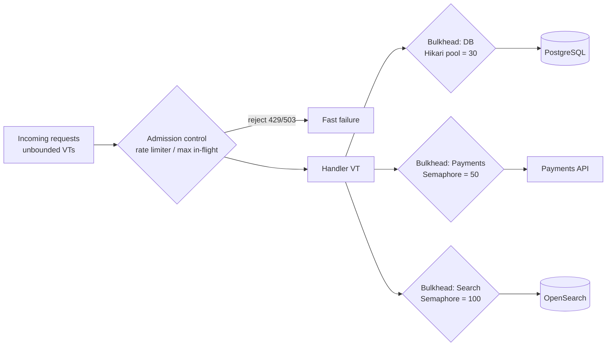

# L5: Patterns & Backpressure

<span class="level l3">L3 · 6–9 yrs</span>

With platform threads, the **pool size was your backpressure**. Once you remove that limit, you must add explicit limits,
or the first traffic spike turns 100k VTs into 100k simultaneous database queries.



## Pattern 1: admission control (max in-flight)

```java
public final class AdmissionFilter implements Filter {
    private final Semaphore inFlight = new Semaphore(5_000);   // from Little's Law + headroom

    @Override public void doFilter(ServletRequest req, ServletResponse res, FilterChain chain)
            throws IOException, ServletException {
        if (!inFlight.tryAcquire()) {                          // never queue unboundedly
            ((HttpServletResponse) res).sendError(503, "Overloaded");
            return;
        }
        try { chain.doFilter(req, res); } finally { inFlight.release(); }
    }
}
```

## Pattern 2: per-dependency bulkhead

The `Bulkhead` from [Synchronizers](../java8-toolkit/synchronizers.md#semaphore-the-virtual-thread-era-rate-limiter)
plus metrics: permits in use, rejections, and wait time. Resilience4j's `SemaphoreBulkhead` is VT-friendly.
**Avoid** `ThreadPoolBulkhead`, because it wraps calls in a platform pool.

## Pattern 3: rate limit (token bucket, VT-friendly)

```java
public final class TokenBucket {
    private final long capacity; private final double refillPerNano;
    private double tokens; private long last = System.nanoTime();
    private final ReentrantLock lock = new ReentrantLock();

    public TokenBucket(long capacity, long perSecond) {
        this.capacity = capacity; this.tokens = capacity; this.refillPerNano = perSecond / 1e9;
    }
    public void acquire() throws InterruptedException {
        while (true) {
            long waitNanos;
            lock.lock();
            try {
                long now = System.nanoTime();
                tokens = Math.min(capacity, tokens + (now - last) * refillPerNano); last = now;
                if (tokens >= 1) { tokens -= 1; return; }
                waitNanos = (long) ((1 - tokens) / refillPerNano);
            } finally { lock.unlock(); }
            Thread.sleep(Duration.ofNanos(waitNanos));   // sleep OUTSIDE the lock; cheap on a VT
        }
    }
}
```

## Pattern 4: fan-out / fan-in with a deadline

Prefer `StructuredTaskScope` ([Structured Concurrency](../modern/structured-concurrency.md)). Without preview features:

```java
<T> List<T> fanOut(List<Callable<T>> calls, Duration deadline) throws InterruptedException {
    try (var ex = Executors.newVirtualThreadPerTaskExecutor()) {
        List<Future<T>> fs = ex.invokeAll(calls, deadline.toMillis(), TimeUnit.MILLISECONDS);
        return fs.stream().filter(f -> f.state() == Future.State.SUCCESS).map(Future::resultNow).toList();
    }
}
```

## Pattern 5: pipeline with bounded stages

See example 12 in [Worked Examples](04-examples.md). Each stage gets N VTs and a bounded queue. Slow stages fill their
input queue, which makes upstream `put` calls block. That's backpressure with no reactive library.

## Pattern 6: hedged requests

See example 20. Use them only for **idempotent** calls, and cap the hedge rate (for example, at most 5% of requests).

## Pattern 7: async-to-sync bridge

Wrap a callback API so callers can write blocking code:

```java
public Message receive(Duration timeout) throws Exception {
    var cf = new CompletableFuture<Message>();
    consumer.onMessage(cf::complete);
    consumer.onError(cf::completeExceptionally);
    return cf.get(timeout.toMillis(), TimeUnit.MILLISECONDS);   // the VT parks; no thread wasted
}
```

## Pattern 8: per-key serialization (actor-lite)

```java
public final class KeyedSerialExecutor {
    private final ConcurrentHashMap<String, ReentrantLock> locks = new ConcurrentHashMap<>();
    public <T> T run(String key, Callable<T> task) throws Exception {
        ReentrantLock l = locks.computeIfAbsent(key, k -> new ReentrantLock());
        l.lock();
        try { return task.call(); } finally { l.unlock(); }
    }
}
```
This is useful for wallet or cart updates where operations on one key must not interleave. Evict idle locks with Caffeine's `weakValues()`,
or use striped locks (`locks[Math.floorMod(key.hashCode(), 1024)]`).

## Pattern 9: one-loop-per-connection with blocking IO

WebSocket or TCP protocols where each connection has a read loop and a write loop: two VTs per connection, coordinated with a
`BlockingQueue` for outbound messages. Before VTs, this needed Netty or NIO selectors.

## Anti-pattern table

| Instead of… | Do |
|---|---|
| `newFixedThreadPool(50, vtFactory)` to limit concurrency | `newVirtualThreadPerTaskExecutor()` + `Semaphore(50)` |
| Unlimited fan-out to a DB | Hikari pool size + `connectionTimeout` |
| `CompletableFuture` chains inside a VT handler | Sequential blocking code |
| Retrying without a deadline | A deadline budget across retries (example 17) |
