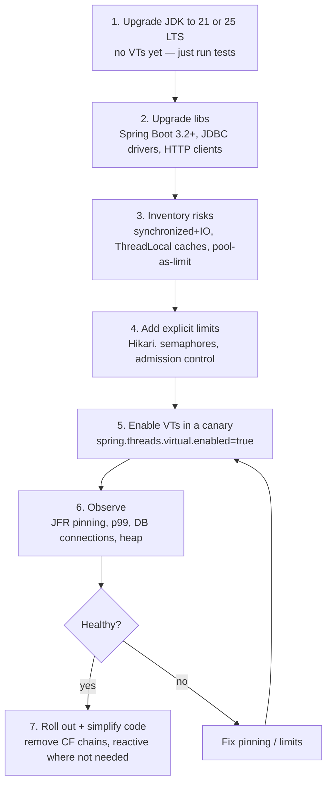

# L6: Migration Guide (Java 8/11/17 → 21/25)

<span class="level l3">L3</span> <span class="level l4">L4</span>

## Migration roadmap



## Step 3: risk inventory checklist

```bash
# synchronized blocks that may wrap IO (relevant on JDK 21–23)
grep -rn "synchronized" src/main/java | grep -v "^.*//"
# ThreadLocal used as a cache
grep -rn "ThreadLocal<" src/main/java
# Pools used as concurrency limiters
grep -rn "newFixedThreadPool\|ThreadPoolTaskExecutor\|setMaxPoolSize" src/main/java
# Native / JNI
grep -rn "native \|System.loadLibrary" src/main/java
```

| Finding | Action |
|---|---|
| `synchronized` around IO (JDK 21–23) | Replace with `ReentrantLock`, or move to JDK 24+ |
| `ThreadLocal` cache of an expensive object | Make it a shared thread-safe instance, a small pool, or create it per use |
| `ThreadLocal` context (MDC, security) | Keep for now (it works). Plan a `ScopedValue` migration on Java 25 |
| Thread pool sized to protect a downstream | Replace with a `Semaphore` of the same size |
| `@Async` pool with a bounded queue | VTs remove the queue. Make sure the work's targets are bounded |
| `parallelStream()` doing IO | Move it to a VT executor |
| Reactive code (WebFlux) with no streaming need | Candidate for rewrite to MVC + VTs (optional, gradual) |

## Before / after: a Java 8 service class

=== "Java 8"

    ```java
    @Service
    public class CheckoutService {
        private final ExecutorService pool = Executors.newFixedThreadPool(32);

        public CheckoutSummary summarize(String cartId) {
            CompletableFuture<Cart> cart = CompletableFuture.supplyAsync(() -> cartClient.get(cartId), pool);
            CompletableFuture<Address> addr = cart.thenComposeAsync(
                    c -> CompletableFuture.supplyAsync(() -> addressClient.get(c.userId()), pool), pool);
            CompletableFuture<Quote> quote = cart.thenComposeAsync(
                    c -> CompletableFuture.supplyAsync(() -> pricingClient.quote(c), pool), pool);
            return addr.thenCombine(quote, (a, q) -> new CheckoutSummary(cart.join(), a, q))
                       .exceptionally(ex -> { throw new CheckoutException(ex); })
                       .join();
        }

        @PreDestroy void stop() { pool.shutdown(); }
    }
    ```

=== "Java 21+ (virtual threads)"

    ```java
    @Service
    public class CheckoutService {
        public CheckoutSummary summarize(String cartId) throws Exception {
            Cart cart = cartClient.get(cartId);                          // sequential dependency stays sequential
            try (var ex = Executors.newVirtualThreadPerTaskExecutor()) {
                Future<Address> addr = ex.submit(() -> addressClient.get(cart.userId()));
                Future<Quote> quote  = ex.submit(() -> pricingClient.quote(cart));
                return new CheckoutSummary(cart, addr.get(), quote.get());
            }
        }
    }
    ```

**Measured effect in a typical migration:** about 45% fewer lines, readable stack traces, no pool to size or shut down,
and the request thread itself is a VT (Spring Boot 3.2+), so the blocking `get()` calls cost nothing.

## Rollout tips (from real migrations)

* Ship the JDK upgrade **separately** from enabling VTs, so you can attribute regressions.
* Toggle with configuration (`spring.threads.virtual.enabled`) so you can roll back without a redeploy.
* Compare these dashboards before and after: p50/p99 latency, throughput, DB active connections, heap after GC, CPU, and
  `jdk.VirtualThreadPinned` count.
* Expect **higher downstream load** at the same traffic. The service now does more in parallel, so check the database's
  `max_connections` and downstream rate limits.
