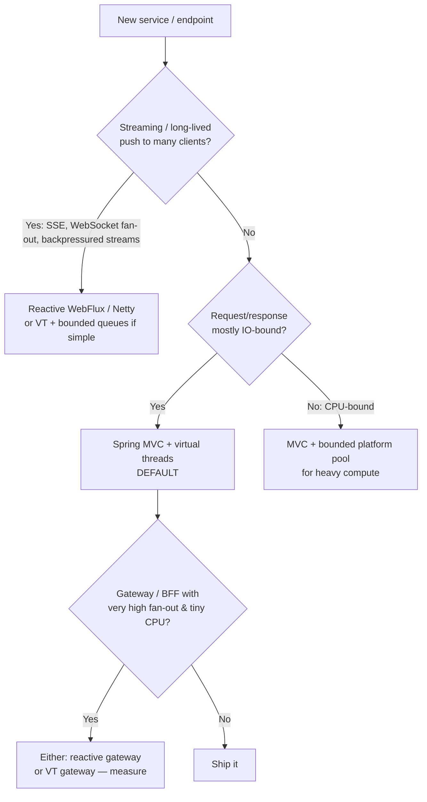

# L9: Architect Level (10–15 years)

L4 · 10–15 yrs

At this level the question is no longer "how do I use a virtual thread". It is:

* "What concurrency model should **every service** on our platform use, and where are the exceptions?"
* "How does that choice change capacity planning, cost, failure modes, hiring, and operability?"

## 1. Platform decision framework

A sound platform rule, which the grocery platform in this org uses:
**"MVC on virtual threads by default; WebFlux only for gateway, BFF, delivery tracking, notifications, search, and the assistant
(streaming)."**

## 2. Capacity modelling with virtual threads

The scarce resources are no longer threads. They are:

| Resource | Limit source | Model |
|---|---|---|
| CPU | Cores × target util | `λ_max = cores × util / cpu_time_per_req` |
| DB connections | DB `max_connections` / replicas | `pool_per_pod = λ_pod × db_time`; `Σ pods × pool ≤ DB limit` |
| Downstream capacity | Their SLO and rate limit | Semaphore = `λ × downstream_latency × 1.2` |
| Heap | Stack chunks + request objects | `in_flight × (stack + request garbage)` |
| File descriptors / sockets | `ulimit -n`, ephemeral ports | In-flight outbound connections |

**Worked example (grocery checkout, per pod):**

* Target 400 req/s per pod. CPU 4 ms/req → 1.6 cores busy (4 cores × 40% util): **OK**
* p99 latency 300 ms → in-flight = 400 × 0.3 = **120 VTs** (trivial)
* Each request: 3 DB queries × 4 ms = 12 ms DB time → `400 × 0.012 = 4.8` connections → **pool = 10**
* 20 pods × 10 = 200 connections against a DB limit of 500: **OK**
* Payments: 50 req/s × 250 ms = 12.5 → **Semaphore(16)**

On Java 8 you'd size Tomcat to about 200 threads per pod "just in case", and still suffer **thread exhaustion** when payments
slowed down to 5 s (400 × 5 = 2000 in-flight > 200 threads → the whole pod stalls). With VTs + `Semaphore(16)`, only the
payments path degrades and every other endpoint stays healthy. **That isolation is the architectural win.**

## 3. Failure-mode analysis

| Failure | Platform-thread service | VT service (with bulkheads) | VT service (no bulkheads) |
|---|---|---|---|
| Downstream slows 10× | Thread pool exhausts, all endpoints fail | Only that dependency's calls fail fast | In-flight grows; heap and DB connections exhausted |
| DB pool exhausted | Threads block on the pool, then the pool exhausts | VTs wait up to `connectionTimeout`, then 503 | Same, but with more waiters |
| Traffic spike 5× | Queueing in Tomcat accept queue | Admission control sheds the excess | GC pressure, cascading timeouts |
| Pinning (JDK 21) | n/a | Throughput collapse under specific code paths | Same |

Lesson: **virtual threads without limits are less safe than platform threads.** The pool was an accidental bulkhead.
Make it intentional.

## 4. Organization-wide adoption plan

1. **Baseline:** JDK 25 LTS, Spring Boot 3.5+/4.x, VT-ready drivers, current APM agent versions.
2. **Golden path template:** service template with VTs on, admission filter, a bulkhead library, and JFR pinning alerts.
3. **Lint rules (ArchUnit / Error Prone):** forbid `Executors.newFixedThreadPool` with a VT factory, forbid `parallelStream`
   in `@Service` IO classes, forbid `ThreadLocal` fields except in an allow-list.
4. **Load-test gate in CI:** compare p99 and pinning between releases.
5. **Training:** this playbook, L1 → L9.
6. **Reactive sunset (optional):** migrate reactive services without streaming needs, one endpoint at a time.

## 5. VT vs reactive: the honest comparison

See [Virtual Threads vs Reactive](../modern/vt-vs-reactive.md). In short: VTs win on **simplicity, debuggability, hiring,
and library compatibility**. Reactive still wins for **streaming with backpressure**, **very high fan-out with tiny
CPU** (where ~1–5% lower overhead matters), and **existing reactive ecosystems** (R2DBC, reactive Kafka).

## 6. Things to watch beyond Java 25

* **Structured concurrency** finalization: the API changed significantly in 25 (`open` + `Joiner`). Wrap it behind an internal facade.
* **Custom VT schedulers** (not yet public API): may later allow per-tenant or NUMA-aware scheduling.
* **Preemption of CPU-bound VTs**: currently none. Keep heavy CPU work on platform pools.
* **JDBC/ORM**: Hibernate and JDBC are blocking-first, which fits VTs. R2DBC usage will likely shrink.
