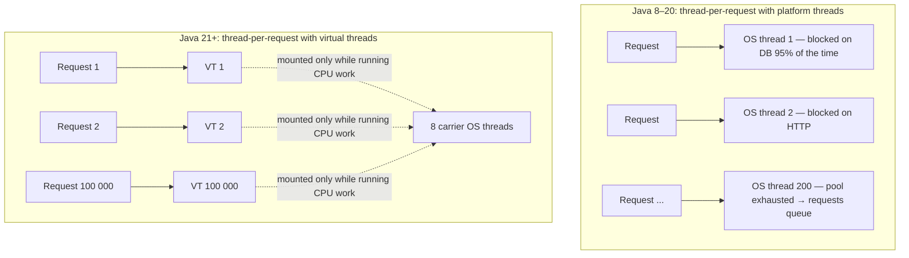

# Virtual Threads: From Basics to Architect

Virtual threads (JEP 444, **final in Java 21**) are the biggest change to Java concurrency since Java 5. This tab is
a nine-level course. Each level assumes the previous ones.

| Level | Page | You will be able to… | Exp. |
|---|---|---|---|
| L1 | [Basics](01-basics.md) | Create VTs, use the VT executor, explain why they're cheap | 0–2 |
| L2 | [How They Work](02-internals.md) | Explain continuations, mount/unmount, carriers, the scheduler | 3–5 |
| L3 | [Pinning & JEP 491](03-pinning.md) | Detect and fix pinning on 21, and explain what changed in 24 | 3–6 |
| L4 | [25 Worked Examples](04-examples.md) | Apply VTs to HTTP, JDBC, files, queues, sockets, batch jobs, … | 2–8 |
| L5 | [Patterns & Backpressure](05-patterns.md) | Bulkheads, rate limits, fan-out/fan-in, pipelines, hedging | 5–9 |
| L6 | [Migration Guide](06-migration.md) | Move a Java 8/11/17 service to VTs safely | 5–10 |
| L7 | [Pitfalls](07-pitfalls.md) | Avoid the 17 mistakes teams actually make | 3–10 |
| L8 | [Observability](08-observability.md) | Use JFR, thread dumps, and metrics with millions of threads | 6–12 |
| L9 | [Architect Level](09-architect.md) | Capacity models, platform-wide adoption, VT vs reactive decisions | 10–15 |

## The idea in one diagram

## Three sentences to remember

1. A virtual thread is a `java.lang.Thread` that the **JVM** schedules onto a small pool of OS **carrier** threads.
2. When it blocks (socket, `sleep`, lock, queue), it **unmounts**: its stack is saved to the heap and the carrier
   runs another VT.
3. So **blocking becomes cheap**, and the simple thread-per-request style scales like async code. That helps throughput,
   not the latency of a single request.
