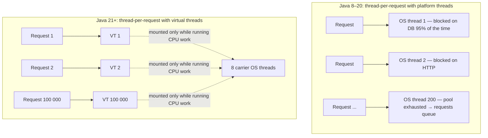

# Virtual Threads: From Basics to Architect

Virtual threads (JEP 444, **final in Java 21**) are the biggest change to Java concurrency since Java 5. This tab is
a nine-level course. Each level assumes the previous ones.

1
:material-sprout:

[L1 · Basics](01-basics.md){ .pb-title }

Create VTs, use the VT executor, explain why they're cheap

0–2 yrs

2
:material-cog-transfer:

[L2 · How They Work](02-internals.md){ .pb-title }

Explain continuations, mount/unmount, carriers, the scheduler

3–5 yrs

3
:material-pin:

[L3 · Pinning & JEP 491](03-pinning.md){ .pb-title }

Detect and fix pinning on 21, and explain what changed in 24

3–6 yrs

4
:material-flask:

[L4 · 25 Worked Examples](04-examples.md){ .pb-title }

Apply VTs to HTTP, JDBC, files, queues, sockets, batch jobs, …

2–8 yrs

5
:material-shield-half-full:

[L5 · Patterns & Backpressure](05-patterns.md){ .pb-title }

Bulkheads, rate limits, fan-out/fan-in, pipelines, hedging

5–9 yrs

6
:material-swap-horizontal:

[L6 · Migration Guide](06-migration.md){ .pb-title }

Move a Java 8/11/17 service to VTs safely

5–10 yrs

7
:material-alert:

[L7 · Pitfalls](07-pitfalls.md){ .pb-title }

Avoid the 17 mistakes teams actually make

3–10 yrs

8
:material-eye:

[L8 · Observability](08-observability.md){ .pb-title }

Use JFR, thread dumps, and metrics with millions of threads

6–12 yrs

9
:material-city-variant:

[L9 · Architect Level](09-architect.md){ .pb-title }

Capacity models, platform-wide adoption, VT vs reactive decisions

10–15 yrs

## The idea in one diagram

## Three sentences to remember

1. A virtual thread is a `java.lang.Thread` that the **JVM** schedules onto a small pool of OS **carrier** threads.
2. When it blocks (socket, `sleep`, lock, queue), it **unmounts**: its stack is saved to the heap and the carrier
   runs another VT.
3. So **blocking becomes cheap**, and the simple thread-per-request style scales like async code. That helps throughput,
   not the latency of a single request.
